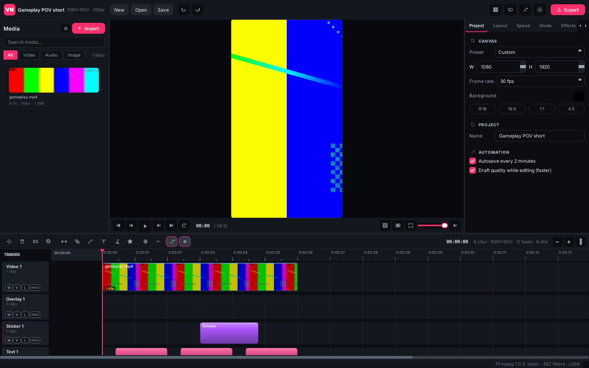

# VN Studio — a video editor for Ubuntu

VN Studio is a native Linux desktop video editor built to feel like VN Video
Editor (VlogNow): a dark, focused workspace with the preview on top, a
multitrack timeline across the bottom, a media bin on the left and a contextual
inspector on the right. It is an independent implementation — original code,
original artwork, and open-licensed fonts — and it runs entirely on your own
machine: no account, no cloud, no subscription, no GPU.



---

## Install

```bash
git clone https://github.com/notryuzakiii67-tech/VN_VIDEO_EDITOR_LINUX
cd VN_VIDEO_EDITOR_LINUX
./install.sh                 # per-user install (recommended)
```

`install.sh` installs FFmpeg and the Qt runtime libraries through `apt` when they
are missing, creates a private Python environment, writes a launcher into
`~/.local/bin/vn-studio`, adds a menu entry, and runs a self-test at the end.
Use `./install.sh --system` to install into `/opt` for all users, or
`./install.sh --no-deps` if you already have ffmpeg and PySide6.

Then start it from your applications menu (**VN Studio**) or:

```bash
vn-studio                      # open the editor
vn-studio my_project.vnp       # open a project
vn-studio --self-test          # report what the machine can do
```

### Manual install (no installer script)

```bash
sudo apt install ffmpeg python3-venv
python3 -m venv .venv && . .venv/bin/activate
pip install -r requirements.txt
python -m vn_editor
```

**Requirements:** Ubuntu 22.04 or newer (or any Debian-family desktop), Python
3.9+, FFmpeg 5+, and about 400 MB of disk. A CPU with SSE2 is enough — every
export runs on the CPU through libx264. On very old machines, set *Preferences →
Preview quality → Low* and export at 720p.

---

## The five-minute tour

1. **Import** — *Import* in the media bin, drag files onto the window, or drop a
   whole folder in. Video, audio and images are all accepted.
2. **Rough cut** — drag a clip from the bin onto a track. Drag its edges to trim,
   drag the body to move, press `S` to split at the playhead, `Delete` to remove.
   Snapping to clip edges, markers and beats is on by default.
3. **Shape it** — select a clip and use the inspector: *Layout* (position, scale,
   rotation, crop, fit), *Speed* (0.05×–8× and speed curves), *Grade* (25 looks),
   *Effects* (39 effects), *Mask*, *Chroma key*, *Audio*.
4. **Animate** — turn on auto-keyframe, move the playhead, change a value: a
   keyframe is recorded. The *Motion* tab lists them and offers 19 presets.
5. **Text** — `T` adds a text clip; the *Text* tab has 21 bundled fonts, outline,
   shadow, background and 24 text animations.
6. **Sound** — *Audio* opens the built-in library (42 sounds, generated locally)
   plus your own files. *Beats* finds the beat in a track and snaps cuts to it.
7. **Export** — `Ctrl+E`. Pick a preset, watch real progress, get an MP4.

---

## Making a Minecraft-style POV short

The workflow this editor is tuned for: landscape gameplay → vertical, zoomed,
sped-up footage with big POV captions and meme sound effects.

| Step | How |
| --- | --- |
| 1. Landscape footage in | Import the recording, drag it to the video track |
| 2. Make it vertical | Inspector → *Layout* → *Fit*: **Cover**, then raise **Scale** to taste. Or *Project → Canvas → 9:16* to switch a whole project |
| 3. Zoom in on the action | *Layout → Scale* (keyframe it, or use *Motion → Zoom in*) and drag on the position pad to reframe |
| 4. Speed it up | *Speed → 1.5×* or *2×*; use a **speed curve** to ramp into a moment |
| 5. Big POV caption | `T`, type `POV: YOU ARE HIM`, pick **Bebas Neue**, and hit a size of ~280 px on a 1080×1920 canvas. Outline 6, shadow 2, animation *Pop in* |
| 6. Meme sound effects | *Audio* → search `fahhh`, `thud`, `get out` → double-click to drop at the playhead (snapped to the nearest beat) |
| 7. Line them up | Zoom the timeline (`Ctrl + scroll`), drag clips and keys; snapping does the rest |
| 8. Preview | `Space` plays in real time with audio |
| 9. Export | `Ctrl+E` → *Vertical 1080p* → Export |

The bundled sound library includes the meme staples (fahhh, thud, vine boom,
get out, bruh, oof, metal pipe, airhorn, record scratch…) and a set of Minecraft
-flavoured effects (anvil, block place, XP, level up, villager, creeper, door,
portal). They are synthesised locally on first run, so they are original assets
and carry no licence questions. Drop your own files into
`~/.local/share/vn-studio/sfx/user/` and they appear in the same list.

---

## What works

Everything below is implemented and exercised by the test suites in `tests/` and
`tools/`; nothing here is a placeholder.

**Project & files**
- New / open / save projects as readable `.vnp` bundles (a zip with JSON inside)
- Autosave every 2 minutes, plus crash recovery on the next start
- Recent projects, relink missing media, recovery folder in Preferences
- Undo/redo on every edit, with gesture coalescing for drags

**Media**
- Import video, audio and images; folders are scanned recursively
- Poster-frame thumbnails and audio waveforms, generated off the UI thread
- Drag from the bin to the timeline, drag files onto the window, drag onto clips
  to replace the underlying media

**Timeline**
- Multiple tracks: video, overlay, text, sticker, audio; add, rename, reorder,
  hide, lock, mute, solo
- Trim, split (0.05 s precision), move, duplicate, delete, ripple
- Snapping to clip edges, playhead, markers and beats
- Beat markers drawn on the ruler; zoom from frame-accurate to whole-timeline

**Picture**
- Position, scale, rotation, flip, crop and fit (fit / cover / stretch)
- 25 colour looks, 39 effects (including two-pass stabilisation), chroma key,
  eight mask shapes with feathering, .cube LUTs with an intensity blend
- Transitions: 65 entries (fades, wipes, slides, spins, circles, composites)
  with adjustable duration and audio crossfade
- Blend PIP overlays on higher tracks with independent transforms and 13 blend
  modes (screen, multiply, overlay, soft/hard light, add, subtract, difference,
  lighten, darken, dodge, burn), alpha-correct so a small PIP never smears the
  background

**Motion & time**
- Keyframes on x / y / scale / rotation / opacity with linear, ease and hold
  interpolation, plus 19 motion presets
- Speed 0.05×–8× with pitch correction, speed curves and ramping
- Reverse, freeze frame, frame stepping

**Text & graphics**
- 21 bundled OFL fonts, size auto-fit, outline, shadow, background, alignment
- 24 text animations (pop, zoom, slide, shake, typewriter…)
- 38 vector stickers in 7 categories, drawn at export resolution
- Captions: paste a script or import `.srt`, and export back to `.srt`;
  local speech-to-text if you have whisper installed

**Audio**
- Per-clip volume, fades in/out, pan, pitch, mute and solo
- Volume keyframes, beat detection with snapping, J/L cuts via fades
- 42 generated sound effects plus your own files

**Export**
- MP4 (H.264 / H.265 / MPEG-4) with selectable resolution, fps, CRF, and preset
- Real progress with frame counts, pause-free cancel, overwrite protection
- Audio-only graphs available for preview use

## What is not there yet

Being straight about the limits:

- **No GPU encoding.** Exports use libx264 on the CPU. That is the right default
  for old machines, but a 4K export of a busy timeline takes minutes.
- **No proxy media and no background rendering.** Scrub previews compile a
  single frame through the same filtergraph as the export, so an extremely
  complex frame can take a moment on a slow CPU.
- **No automatic scene detection, no motion tracking, no face tracking, no AI
  cutout.** Auto captions depend on you installing whisper locally.
- **Text wrapping is basic** (explicit newlines and auto-shrink rather than
  balanced rewrapping).
- **Stabilisation** runs a real two-pass `vidstabdetect` → `vidstabtransform`
  job. The analysis is cached per clip in `~/.cache/vn-studio/stab`, so the
  first preview of a stabilised clip pauses for a moment and later ones do not.
  A clip with stabilisation on is previewed by decoding from the start of the
  clip rather than seeking, because the transform file is read frame by frame.
- **QtMultimedia** is only used for audio output; there is no Qt-based video
  playback path, so preview always goes through FFmpeg.

---

## Keyboard

| Key | Action | Key | Action |
| --- | --- | --- | --- |
| `Space` | Play / pause | `S` / `Ctrl+B` | Split at playhead |
| `←` `→` | One frame | `Shift+←/→` | One second |
| `Home` / `End` | Start / end | `F` | Fullscreen preview |
| `I` / `O` | Trim to playhead | `[` `]` | Nudge one frame |
| `Ctrl+Z` / `Ctrl+Shift+Z` | Undo / redo | `Ctrl+D` | Duplicate |
| `Ctrl+K` | Keyframe | `Ctrl+M` | Marker |
| `Ctrl+T` | Add text | `Ctrl+Shift+C` | Captions |
| `Ctrl+I` | Import | `Ctrl+Shift+B` | Beats |
| `Ctrl+E` | Export | `Ctrl+Scroll` | Zoom timeline |
| `Ctrl+N/O/S` | New / open / save | `F1` | All shortcuts |

---

## How it is built

```
vn_editor/
  __main__.py          entry point, self-test, recovery prompt
  core/
    ffmpeg.py          toolchain discovery and capabilities
    probe.py           native MP4/MKV/WAV/MP3/FLAC/OGG parsers (no ffprobe needed)
    model.py           project model: clips, tracks, keyframes, transforms
    project.py         .vnp save/load, autosave, recovery, recents, settings
    undo.py            snapshot and function commands, transactions, coalescing
    expr.py            keyframe evaluation and expression helpers
    ass.py             libass authoring: text, captions, vector stickers
    fonts.py           TrueType metric parsing, auto-fit, wrapping
    effects.py         39 effects and 25 colour looks
    transitions.py     65 transitions (real xfade names + composites)
    speedcurve.py      speed curves and ramping maths
    audio.py           mix, fades, pitch, loudness limiting
    sfx.py             42 procedurally generated sound effects
    stickers.py        38 vector stickers
    render.py          the filtergraph builder, the exporter and the frame renderer
  ui/
    theme.py           palette, style sheet, ~73 procedural icons
    widgets.py         sliders, chips, colour buttons, preset strips, param editor
    timeline.py        ruler, tracks, clips, keyframes, markers, snapping
    player.py          scrub worker, frame reader, audio output, thumbnails
    media.py           media bin with thumbnails and drag-out
    inspector.py       per-kind property pages
    dialogs.py         export, transitions, stickers, audio, beats, captions, …
    main_window.py     the workspace that ties it together
```

The preview and the export share one filtergraph builder, so what you see is
what you get: the preview pipes raw frames from the same graph at a lower
resolution, and the frame stills used while scrubbing come from the same code
path. `tools/feature_audit.py` proves that shared code by rendering every
catalogue entry — all 39 effects, 25 colour looks, 65 transitions, 24 text
animations, 10 caption presets, 13 overlay blend modes, 38 stickers, 8 mask
shapes, 8 speed curves, 12 easing curves, 5 export presets, 42 sound effects —
and measuring that the picture or the audio actually changes, so a control that
renders but does nothing cannot pass unnoticed.  A transition is judged against
the very same project rendered as a plain cut, and has to keep the run's length
so a transition never shifts the timeline; the audio group measures the level of
the written file, so volume, mute and fades are proven audible rather than
assumed.  The audit refuses to run if its baseline frame is a flat colour,
i.e. if the test clip is not reaching the frame at all.  Tables the UI and the
renderer share (blend modes, speed-curve presets, mask shapes, caption presets)
live in the core so the two cannot drift apart. Filters, effects, masks and overlays are only listed in the UI
when this build of FFmpeg actually provides them.

## Tests

```bash
python tests/test_render.py                  # 30 engine/render checks (~38 s)
python tools/feature_audit.py                # renders every catalogue entry (~35 s)
python tools/export_check.py                 # the POV-short workflow, verified
python tools/gui_smoke.py                    # 26 headless GUI checks + screenshots
python -m vn_editor --self-test              # environment report
```

Two things the suites guard that are easy to get wrong in an NLE renderer: a
multi-clip run lays its clips out end to end with no gap and no clipped tail
(the test renders two clips and checks that neither a hole at the join nor the
end of the second clip shows the background), and a transition is drawn *over*
the cut — the outgoing clip's last frame is held for the transition's duration
while the incoming clip fades in — instead of silently collapsing into a hard
cut.  Both of those were real bugs, found by these checks rather than by
watching output, and both now have regression tests.

Audio is decided by the media, not by a flag: a clip whose file has no audio
track exports normally with audio enabled (this used to fail outright with
"Error binding filtergraph inputs/outputs" because the mix referenced a stream
that was never there), and a stale ``has_audio`` flag is overridden by what the
file actually contains.

`tools/export_check.py` walks the primary workflow — 16:9 gameplay into a 9:16
canvas, zoomed, sped up 1.5x, with Bebas Neue captions, a sticker and three
meme sound effects — and then proves each part is in the file: the captions and
sticker are measured by re-rendering with those tracks hidden and counting the
pixels they occupy, and the effects are measured by re-rendering with the audio
track muted and comparing peak levels in their windows.

On a desktop the GUI checks run directly. On a headless machine (no GL/X11/dbus
at all, like a container) generate stub platform libraries first:

```bash
python tools/qt_offscreen_shim.py --out /tmp/qtshim
LD_LIBRARY_PATH=/tmp/qtshim QT_QPA_PLATFORM=offscreen python tools/gui_smoke.py
```

## Licensing

The application code is original work. The 21 bundled fonts are under the SIL
Open Font License (`vn_editor/resources/fonts/OFL-LICENSE.txt`). Stickers,
icons, sound effects and the waveform artwork are generated by the program
itself. FFmpeg is used as an external program and is not redistributed here.

VN Studio is not affiliated with Ubiquiti Labs, VlogNow, or VN Video Editor; the
name is used only to describe the kind of editor this is.
