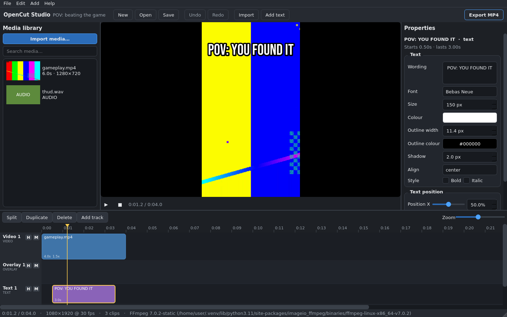

# OpenCut Studio

**A simple, professional open-source desktop video editor for Ubuntu Linux.**

*Professional power underneath. Simplicity on the surface.*

> The name "OpenCut Studio" is **provisional**. No trademark search has been
> performed and no availability is claimed.



OpenCut Studio takes inspiration from the *workflows* of editors like
Premiere Pro, DaVinci Resolve, CapCut and VN — never their code, branding or
assets. The interface is original, and so is every line of this project.

## What works today (Phase 5, v0.5.0)

- Native Ubuntu desktop app (Python + PySide6/Qt), dark, uncluttered UI:
  top bar, media library, preview, properties panel, multitrack timeline.
- **Projects**: create (16:9, 9:16, 1:1, 4:5, 4:3, 21:9 or custom size),
  save and reopen in the versioned `.opencut` JSON format, recent-projects
  list, unsaved-changes protection.
- **Media**: import video / audio / images with real metadata inspection
  (streams, resolution, duration, codecs). Unusable files are rejected with
  a specific reason — nothing is ever silently dropped. Thumbnails and audio
  waveforms are generated in the background.
- **Timeline**: video, overlay, text and audio tracks; select, drag to move,
  drag edges to trim, split (double-click, `S`, or the button), duplicate,
  delete, zoom, snapping to the playhead and clip edges, track hide/mute.
- **Editing**: position / scale / rotation / opacity / fit (fit, cover,
  stretch) with pan-focus for reframing; constant playback speed
  (0.1×–8× class range, UI presets 0.25×–4×); text clips with font
  (21 bundled families incl. Bebas Neue), size, colour, outline, shadow,
  alignment and position; per-clip volume, pan, fade in/out and mute.
- **Preview**: frame-accurate scrub stills rendered with the same graph the
  exporter uses, plus real-time playback synchronised to the audio clock.
- **Export**: real MP4 (H.264 + AAC) rendering with presets (Original /
  Balanced / Small / Draft), progress bar, cancellation, and a post-render
  check that re-probes the file. Export errors are reported, never hidden.
- **Undo/redo** for every edit (250-step snapshot history).

### New in Phase 2

- **Edit modes**: ripple, roll, slip and slide edits and ripple delete
  (toolbar or `V`/`B`/`N`/`Y`/`U`), snapping toggle with playhead
  snapping, and lockable tracks (**L**/**H**/**M** header buttons).
- **Keyframes**: position, scale, rotation, opacity and volume can be
  animated with easing curves. The inspector evaluates the value at the
  playhead; diamonds on the timeline mark keyframes (click one to jump
  to it). Preview and export evaluate identically — the acceptance test
  asserts pixel agreement between them.
- **Titles**: six built-in animated title presets (big Bebas Impact and
  friends), plus your own saved presets in the *Add title* menu.
- **Transitions** with adjustable duration, **speed curves** (presets
  or a custom point editor), **clip reverse**, and audio **fade curves**
  on top of volume keyframes.
- **Export presets**: Original / Balanced / Small / Draft / Web 720 /
  Master, all validated after rendering.
- 80 automated tests, including a Phase 2 acceptance test (multitrack
  edit with animated title, transitions, speed curve, reversed PiP and
  audio keyframes → save → reopen → export → verify) and regression
  tests for four engine bugs that test found. See
  [docs/PHASE2_REPORT.md](docs/PHASE2_REPORT.md).

### New in Phase 3

- **Background workers**: thumbnails, waveforms, proxy generation, media
  analysis and exports all run on a QThreadPool — the UI never blocks.
- **Proxy media**: large video files are transcoded to lightweight
  half-height H.264 proxies for faster preview; generated per-asset
  (context menu) or for all assets (File → Generate proxies).
- **Preview quality selector** (Draft / Low / Half / Full): lower the
  preview resolution for faster iteration on 4K or long timelines.
- **Autosave + crash recovery**: 20-second autosave timer writes
  recovery snapshots; a startup dialog offers to restore the latest one.
- **Media relinking**: right-click a missing asset → Relink, or use
  File → Relink missing media to locate moved files.
- **Render queue**: queue multiple exports in the background, with
  progress and cancellation. The export dialog has "Add to queue" and
  "Export now" buttons.
- **VFR detection**: imported files are checked for variable frame rate;
  a warning suggests re-encoding if detected.
- **Media panel**: proxy (◈) and missing (⚠) indicators on asset labels.
- 118 automated tests. See [docs/PHASE3_REPORT.md](docs/PHASE3_REPORT.md).

### New in Phase 4

- **Colour grading**: brightness, contrast, saturation, gamma and
  temperature sliders in the inspector, backed by the engine's filter
  system with per-parameter undo.
- **Compositing**: 13 blend modes (normal, screen, multiply, overlay,
  …), 8 mask shapes (rect, ellipse, radial, heart, star, …) with
  feather/size/invert, and chroma key with similarity/blend sliders.
- **Effects panel**: add any of 38 effects across 6 categories (Basic,
  Colour, Blur & Sharp, Light, Stylise, Repair), per-parameter live
  sliders, enable/disable, remove.
- **Audio processing**: 3-band EQ, bass/treble boost, compressor,
  denoise, echo, reverb, highpass/lowpass, normalize — all undoable.
- 146 tests through Phase 4. See [docs/PHASE4_REPORT.md](docs/PHASE4_REPORT.md).

### New in Phase 5

- **Plugin architecture** (`opencut/plugins.py`): discover, load, and
  manage plugins from `plugins/` (bundled) or user home directory. Five
  typed plugin interfaces: effect, transition, title, importer, exporter.
  Every failure mode is caught and logged — broken plugins never crash
  the app. Two bundled examples (warm effect, gaming title).
- **Optional AI architecture** documented: opt-in, local-first, never
  required, no media upload without consent. Specific features
  (transcription, silence/scene detection, smart reframing) investigated
  for future contributors.
- **Repository maturity**: PR template, issue templates, release
  checklist, updated security policy with plugin guidance.
- 177 automated tests across all five phases.
  See [docs/PHASE5_REPORT.md](docs/PHASE5_REPORT.md).

**All five phases of the development plan are complete.**

The roadmap lives in [docs/ROADMAP.md](docs/ROADMAP.md).

## Install on Ubuntu

```bash
sudo apt update
sudo apt install -y ffmpeg python3 python3-venv python3-pip \
  libgl1 libegl1 libxkbcommon0 libdbus-1-3

git clone <this-repository>
cd VN_VIDEO_EDITOR_LINUX/opencut-studio

python3 -m venv .venv
.venv/bin/pip install -r requirements.txt
.venv/bin/python main.py
```

> **Repository layout note.** OpenCut Studio currently lives inside the
> VN_VIDEO_EDITOR_LINUX repository and uses that repository's media engine
> (`vn_editor.core`, GPL-3.0) through a thin adapter (`opencut/engine.py`).
> Run it from this checkout as shown above; if the project is later split
> into its own repository, the engine package is vendored alongside.
> See [docs/ARCHITECTURE.md](docs/ARCHITECTURE.md).

No FFmpeg? Install it with apt (above) — without it the editor still opens
and edits projects, but cannot preview frames or export. Alternatively
`pip install imageio-ffmpeg` provides a bundled static FFmpeg the engine
uses as a fallback.

## The 60-second POV workflow (the one this editor is tuned for)

1. **File → New project**, choose **9:16 Vertical**.
2. **Import** your landscape gameplay and your meme sounds.
3. Double-click the gameplay to add it. In **Properties**: Fit = *cover*,
   Scale ≈ 135%, adjust Pan focus to frame the action.
4. Set **Speed** to 1.5× (or your taste).
5. **Add text**, write `POV: …`, font **Bebas Neue**, drag it where it
   belongs on the timeline; size/position from Properties.
6. Double-click each sound effect and drag it to the exact frame; set
   volume/fades in Properties.
7. Press play, scrub to check, **Ctrl+S** to save.
8. **Export MP4** → *Balanced* → done. The file is verified after rendering.

## Testing

```bash
.venv/bin/pip install -r requirements-dev.txt
.venv/bin/python -m pytest        # 177 tests, incl. all phases
.venv/bin/python main.py --self-test
```

Tests generate their own synthetic media with FFmpeg (no downloaded
fixtures) and include an end-to-end acceptance test that builds the POV
edit above, saves/reopens it, exports it, and verifies the caption pixels
and the sound effect's timing *in the decoded output*.

## Licence

GPL-3.0-or-later — see [LICENSE](LICENSE). The licence choice (and why not
MIT) and the licence of every dependency, font and bundled binary are
recorded in [docs/DEPENDENCIES.md](docs/DEPENDENCIES.md).

## Project documents

- [Architecture](docs/ARCHITECTURE.md) · [Dependencies & licences](docs/DEPENDENCIES.md)
- [Roadmap](docs/ROADMAP.md) · [Phase 1 report](docs/PHASE1_REPORT.md) · [Phase 2 report](docs/PHASE2_REPORT.md) · [Phase 3 report](docs/PHASE3_REPORT.md) · [Phase 4 report](docs/PHASE4_REPORT.md) · [Phase 5 report](docs/PHASE5_REPORT.md)
- [Contributing](CONTRIBUTING.md) · [Security](SECURITY.md) · [Changelog](CHANGELOG.md)
